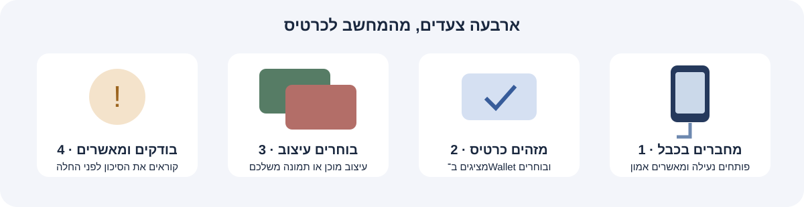
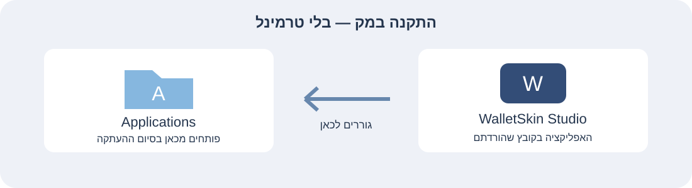

# WalletSkin Studio

**אפליקציה למק, מוכנה להורדה ולהתקנה.**

WalletSkin Studio מגיעה כאפליקציה ארוזה עם ממשק בעברית, עיצובים מוכנים והדרכה בתוך האפליקציה. מורידים את המתקין, מעתיקים ליישומים ומתחילים להשתמש. אין צורך לערוך קבצים, לשכפל את המאגר או לבנות את התוכנה.

בוחרים תמונה, רואים תצוגה מקדימה ומייצאים PNG. לחיבור לאייפון משתמשים בכבל USB. אין שרת, הרשמה לאפליקציה או מנוי.

[**⬇ הורדת האפליקציה למק — גרסה 0.3.2**](https://github.com/razmazlih/walletskin-studio/releases/download/v0.3.2/WalletSkin-Studio-0.3.2.dmg)

[דף הגרסה ופרטי ההורדה](https://github.com/razmazlih/walletskin-studio/releases/tag/v0.3.2) · [התקנה מאפס](#installation) · [מדריך שימוש](#usage) · [פתרון תקלות](#troubleshooting)

> **לפני שמתחילים:** עיצוב וייצוא תמונה זמינים בלי טלפון. החלת התמונה על iPhone עדיין ניסיונית ולא אומתה מקצה לקצה. המנגנון עלול לפגוע בנתוני Books, ואין שחזור מאומת לתמונת הכרטיס המקורית. קראו את האזהרה לפני אישור שינוי.

## מה צריך להכין?

- **MacBook, iMac או Mac mini** עם macOS 14 ומעלה; מתאים למעבדי Apple Silicon וגם Intel.
- לשינוי באייפון: **iPhone וכבל USB שמעביר נתונים**, ומק שמחובר אליו פיזית. שליחת תמונה מרחוק אפשרית; ההחלה עצמה נעשית בחיבור הכבל.
- גישה למאגר הפרטי הזה. כל חבר צריך לקבל הזמנה לחשבון GitHub שלו ולקבל אותה לפני ההורדה.
- לחיבור מכשיר נדרשים כלי Apple הכוללים Python. אם הם חסרים, האפליקציה מציגה כפתור התקנה ופותחת את חלון ההתקנה של Apple. זו הכנה חד־פעמית, וייתכן שתיקח כמה דקות ותדרוש אינטרנט. אין צורך להתקין את Xcode המלא או להקליד פקודות.

**זו אפליקציית Mac. היא אינה פועלת ב־Windows או Linux ואינה מותקנת באייפון.** גרסאות iOS חדשות או בטא עשויות להיחסם; אין הבטחת תאימות לכל אייפון.

## מתקינים מאפס — בלי טרמינל

1. **מקבלים גישה.** נכנסים ל־GitHub ומאשרים את ההזמנה למאגר. אם הקישור מציג 404, ודאו שנכנסתם לחשבון שהוזמן.
2. **מורידים את האפליקציה.** [לוחצים כאן להורדת המתקין](https://github.com/razmazlih/walletskin-studio/releases/download/v0.3.2/WalletSkin-Studio-0.3.2.dmg). שם הקובץ הוא **WalletSkin-Studio-0.3.2.dmg**. אם אתם בדף הגרסה, בחרו בקובץ הזה תחת **Assets**. אין צורך בכפתור Code או בקבצים בשם Source code.
3. **פותחים את ההורדה.** ב־Finder נכנסים ל־**Downloads / הורדות** ולוחצים פעמיים על קובץ ה־DMG.
4. **גוררים לאפליקציות.** בחלון שנפתח גוררים את **WalletSkin Studio** אל **Applications / יישומים** וממתינים לסיום ההעתקה.
5. **פותחים מהמק.** ב־Finder פותחים **Applications / יישומים**, ואז את **WalletSkin Studio**. אחרי ההעתקה אפשר להוציא את דיסק ההתקנה מסרגל הצד של Finder.
6. **אם מופיעה הכנה חד־פעמית:** לוחצים באפליקציה על **התקנת רכיב Apple…**, מאשרים בחלון של Apple וממתינים לסיום. חוזרים לאפליקציה ולוחצים **בדיקת ההתקנה**.

*זהו איור הדרכה. העיצוב המדויק של חלון Finder עשוי להשתנות.*

### המק אומר שלא ניתן לאמת את המפתח?

האפליקציה חתומה בחתימה מקומית בלבד; אין לה חתימת Developer ID או notarization של Apple. לכן macOS עשוי לחסום את הפתיחה הראשונה.

אחרי שניסיתם לפתוח את האפליקציה ובדקתם שהורדתם מהמאגר הזה: פתחו **הגדרות המערכת → פרטיות ואבטחה**, גללו להודעה על WalletSkin Studio ולחצו **פתיחה בכל זאת**, אם האפשרות מופיעה, ואז אשרו. במק של עבודה ייתכן שנדרשת עזרת מנהל המחשב. אין צורך לכבות Gatekeeper או SIP, ואין צורך בפקודות להסרת הגנות.

## בוחרים תמונה יפה

שלושה עיצובים מקוריים כלולים באפליקציה, ללא הורדה נוספת או סימני בנק:

| לילה כחול | מרווה | שקיעה |
|:---:|:---:|:---:|
|  |  |  |

בסעיף **3 · בחירת העיצוב** לוחצים על העיצוב שרוצים. אפשר גם לבחור **בחירת תמונה מהמחשב…** ולהעלות PNG, JPEG או HEIC. התמונה המקורית נשארת ללא שינוי. תפריט **התאמה מתקדמת** הוא לבחירה בלבד — אפשר להתחיל בברירת המחדל.

רוצים רק להכין תמונה? אין צורך לחבר אייפון. בוחרים עיצוב ולוחצים **ייצוא PNG…**. בוחרים היכן לשמור, למשל שולחן העבודה. הקובץ נשמר בגודל 1536 × 969 ומתאים גם לשליחה לחבר.

## משנים תמונה — ארבעה שלבים ברורים

בחלק העליון של האפליקציה מופיעה הפעולה הבאה, וכפתורי 1–4 מעבירים ישירות לסעיף הרצוי.

### 1 · מחברים את האייפון

מחברים בכבל USB למק ופותחים את נעילת האייפון. אם נשאלתם **לתת אמון במחשב הזה?**, מאשרים באייפון ומקלידים בו את קוד הנעילה. ב־Finder אפשר לבחור באייפון בסרגל הצד ולהשלים **Trust / תן אמון** אם מופיע. חוזרים לאפליקציה ולוחצים **רענון וחיבור מחדש**. אם חוברו כמה מכשירים, בוחרים את הנכון.

### 2 · מזהים ובוחרים כרטיס

לוחצים **גילוי כרטיס פעיל (45 שניות)**. בזמן הסריקה פותחים Apple Pay באייפון, מזדהים ומציגים את הכרטיס הרצוי. אין צורך לבצע תשלום. הסריקה מסתיימת כשמתקבל זיהוי, או כשתם הזמן.

באפליקציה לוחצים על הכרטיס שזוהה בבדיקה הנוכחית. האפליקציה אינה קוראת שם בנק או את תמונת המקור; המספר המקומי אינו מיקום הכרטיס ב־Wallet. אם מופיעים כמה מזהים ולא ברור איזה כרטיס הוא הנכון, עוצרים וסורקים שוב כשמציגים כרטיס אחד בלבד. כרטיס שזוהה בעבר בלבד אינו מספיק לאישור החלה.

### 3 · בוחרים עיצוב

לוחצים על אחד משלושת העיצובים המוכנים או בוחרים תמונה מהמחשב. בודקים את התצוגה המקדימה. ברירת המחדל ממלאת את המסגרת כולה; ביחס תמונה שונה היא עשויה למתוח את התמונה. אפשר לשנות זאת ב־**התאמה מתקדמת**. לכל כרטיס עיצוב נפרד, לכן בחרו את כרטיס היעד לפני העיצוב.

### 4 · בודקים ומאשרים

לוחצים **החלה על iPhone…**. בחלון האישור בודקים שוב את המכשיר, הכרטיס והתמונה. קוראים את אזהרת Books ואת מגבלת השחזור ומאשרים רק אם בוחרים לקבל את הסיכון. בלי האישור לא מתבצעת החלה.

משאירים את האייפון מחובר ופתוח עד לסיום. לאחר מכן סוגרים את Wallet דרך מחליף האפליקציות ופותחים שוב. בודקים את **אותו כרטיס** באייפון; אם התמונה לא התעדכנה, אפשר להפעיל את האייפון מחדש. מסמנים באפליקציה **ראיתי את העיצוב בכרטיס הנכון ב־Wallet** רק אחרי שבאמת ראיתם אותו. סיום ההעברה אינו הוכחה שהתמונה השתנתה.

## רוצים להכיר את האפליקציה בלי לגעת באייפון?

הפעילו **מצב הדגמה** בסעיף החיבור. מוצגים מכשיר וכרטיס הדגמה, ואפשר להכיר את השלבים בלי תקשורת עם אייפון. סריקת ההדגמה נמשכת כ־15 שניות. הצלחה בהדגמה אינה הוכחת פעולה במכשיר אמיתי. כבו את המתג לפני שימוש אמיתי.

## משהו לא עובד?

| מה רואים | מה עושים |
|---|---|
| GitHub מציג 404 | נכנסים לחשבון שהוזמן ומקבלים את ההזמנה למאגר הפרטי. |
| לא נמצא iPhone | פותחים נעילה, מנסים כבל נתונים או חיבור USB אחר, משלימים Trust ב־Finder ואז מרעננים באפליקציה. |
| הודעה על רכיב Apple חסר | לוחצים **התקנת רכיב Apple…**. אם חלון ההתקנה לא נפתח, בודקים עדכונים ב־**הגדרות המערכת → כללי → עדכוני תוכנה** או פונים לעזרת מנהל המק. |
| מכשיר לא נתמך או גרסת בטא | ההחלה אינה זמינה. אפשר להמשיך לעצב ולייצא תמונה; אין לעקוף את חסימת התאימות. |
| לא זוהה כרטיס | מתחילים סריקה חדשה, מזדהים באייפון ומציגים את הכרטיס הרצוי במשך הסריקה. |
| כפתור ההחלה אפור | קוראים את ההנחיה ליד הכפתור: נדרשים מכשיר נתמך, כרטיס שנבחר מזיהוי חי ותמונה. |
| התמונה נראית מתוחה | פותחים **התאמה מתקדמת**, מכבים מתיחה ובוחרים שמירת יחס מקורי או חיתוך. |
| פעולה נכשלה או נותק הכבל | בודקים את הכרטיס באייפון. לא מניחים שהתמונה או Books שוחזרו. אם מופיעה חסימת Recovery, לא מוחקים אותה כדי לעקוף את החסימה. |

תמונות, שיוכי כרטיסים ונתוני התאוששות נשמרים מקומית במק. **אל תצרפו לדיווח תקלה** נתוני מכשיר, מזהי כרטיס, תמונות אישיות, יומנים או תוכן תיקיית `~/Library/Application Support/WalletSkin Studio/Recovery`. תיקייה זו אינה גיבוי מאומת של תמונת המקור.

## פרטים נוספים ורישיון

[אבטחה](docs/SECURITY.md) · [מגבלות בדיקת מכשיר](docs/DEVICE-VALIDATION.md) · [אימות הגרסה](docs/VALIDATION.md)

AirCard מאת Mak5er / Johnny Franks והשותפים; AirLift מאת 0xjohnny. רישיון MIT והקרדיטים נשמרים במאגר ובאפליקציה. ראו LICENSE ו־upstream/AirCard/LICENSE. שלושת העיצובים המוכנים מקוריים ונכללים ברישיון הפרויקט.

ההורדה זמינה למי שקיבל גישה למאגר הפרטי. את ההתקנה מבצעים מקובץ ה־DMG בלבד; התיעוד הטכני וקובצי המקור אינם נדרשים לשימוש באפליקציה.

