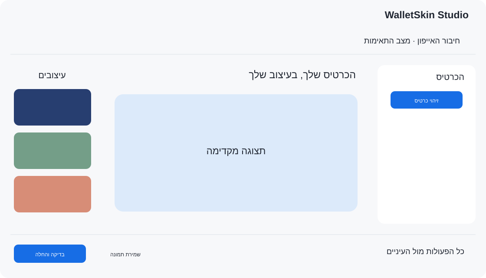

<div dir="rtl">

<p align="center">
  
  
  
</p>

# WalletSkin Studio

**הכרטיס שלכם. העיצוב שלכם. מסך עבודה אחד.**

אפליקציה למק לעיצוב תמונות לכרטיסי Wallet, עם תצוגה מקדימה, שלוש דוגמאות מוכנות והתאמות לתמונה אישית. הממשק זמין בעברית ובאנגלית, ואפשר לעצב ולייצא PNG גם בלי לחבר iPhone.

<p align="center"><strong>macOS 14+ · Apple Silicon & Intel · עברית / English · MIT</strong></p>

[**הורדת גרסה 0.4.0 למק**](https://github.com/razmazlih/walletskin-studio/releases/download/v0.4.0/WalletSkin-Studio-0.4.0.dmg) · [כל הגרסאות](https://github.com/razmazlih/walletskin-studio/releases)



*איור של מבנה הממשק, לא צילום מסך.*

> **לפני שמתחילים:** החלה על iPhone היא ניסיונית. **iOS 27.2 חסום להחלה**, ואין שחזור מאומת לתמונת הכרטיס המקורית. עיצוב וייצוא תמונה זמינים גם ללא החלה.

[התקנה](#מתקינים) · [מדריך שימוש](#משתמשים) · [תאימות](#תאימות-ומגבלות) · [שחזור ובנייה](#שחזור-ובנייה-מהמקור) · [תיעוד](#תיעוד-לפי-נושא)

## מה אפשר לעשות

| פעולה | מה מקבלים |
|---|---|
| להתחיל מדוגמה | חצות, מרווה או שקיעה — עיצובים מקוריים הכלולים בפרויקט. |
| לבחור תמונה אישית | תצוגה מקדימה ואפשרויות התאמה בחלונית נפרדת. |
| לשמור עיצוב | ייצוא PNG, גם ללא טלפון מחובר. |
| להתנסות בהדגמה | היכרות עם התהליך בלי לשנות iPhone. |
| לזהות ולהחיל | תהליך למכשיר נתמך, עם בדיקות ואישור נפרד לפני כתיבה. |

## מתקינים

נדרש macOS 14 ומעלה, Intel או Apple Silicon. מורידים את ה־DMG, פותחים וגוררים את האפליקציה ל־Applications. המאגר פרטי: להורדה צריך להתחבר לחשבון GitHub שקיבל גישה.

האפליקציה חתומה מקומית ואינה מאומתת בידי Apple. אם macOS חוסם אותה, לאחר בדיקת מקור ההורדה פותחים הגדרות מערכת ← פרטיות ואבטחה ← פתיחה בכל זאת, אם האפשרות מוצגת.

## משתמשים

1. **כרטיס:** מחברים iPhone בכבל, פותחים נעילה ומאשרים אמון ב־Finder. לוחצים **זיהוי כרטיס** ומציגים את הכרטיס הרצוי ב־Wallet.
2. **עיצוב:** בוחרים אחת משלוש הדוגמאות או **תמונה מהמחשב**. התצוגה מתעדכנת במרכז. **התאמת התמונה** פותחת אפשרויות נוספות.
3. **סיום:** **שמירת תמונה** מייצאת PNG בלי צורך בטלפון. **בדיקה והחלה** מציגה את הכרטיס, העיצוב והסיכונים לפני אישור נפרד.

אין גלילה במסך העבודה הרגיל. אם זוהו כרטיסים רבים, רק רשימת הכרטיסים נגללת. עזרה קצרה ומצב הדגמה זמינים בכפתור **?**. ההדגמה אינה משנה iPhone.

## תאימות ומגבלות

**iOS 27.2 אינו נתמך להחלה.** אישור אמון אינו משנה את מגבלת התאימות. אפשר להמשיך לעצב ולשמור תמונה.

ההחלה ניסיונית, כותבת גם נתוני Books וקובצי ביניים, ועלולה לגרום לאובדן נתונים. אין שחזור מאומת לתמונת המקור. טווח הגרסאות 18.0–27.0.1 מבוסס על טענת המקור ואינו אימות לכל מכשיר; בטאות וגרסאות לא מזוהות חסומות.

המספור מקומי ואינו סדר הכרטיסים ב־Wallet. האפליקציה אינה קוראת שם בנק או תמונת מקור. בוחרים כרטיס שזוהה בסריקה הנוכחית. לאחר ההחלה פותחים מחדש את Wallet ובודקים את הכרטיס בפועל לפני אישור התוצאה.

## פתרון קצר לתקלות

| מה קרה | מה עושים |
|---|---|
| המכשיר לא מופיע | USB, פתיחת נעילה, אישור אמון ב־Finder ואז רענון. מוצגים רק מכשירי iPhone שפרטיהם נקראו בהצלחה. |
| גרסה לא נתמכת | אפשר לעצב ולשמור PNG; ההחלה נשארת חסומה. |
| חסר רכיב Apple | פותחים **?** ומתקינים דרך חלון Apple, ואז בודקים שוב. |
| לא זוהה כרטיס | מתחילים זיהוי חדש ומציגים כרטיס אחד ב־Wallet. |
| ההחלה אינה זמינה | נדרשים מכשיר נתמך, כרטיס מזיהוי חי ותמונה. |
| פעולה נכשלה או הכבל נותק | בודקים את Wallet. לא מניחים שבוצע שחזור ולא עוקפים חסימת Recovery. |

הנתונים נשמרים מקומית. אין לצרף לדיווחי תקלה מזהי מכשיר, מזהי כרטיסים, תמונות אישיות או תוכן Recovery.

## שחזור ובנייה מהמקור

קוד האפליקציה, העיצובים, הבדיקות והתיעוד נמצאים ב־Git. רכיב AirCard משויך כ־submodule לגרסה קבועה; חשוב לשכפל **עם תתי־המאגרים**. המאגר פרטי ונדרשת הרשאת גישה ל־GitHub.

דרישות לבנייה: Mac עם macOS 14 ומעלה, כלי הפיתוח של Apple הכוללים Swift ו־macOS SDK, ו־Python 3 הזמין בנתיב `/usr/bin/python3`. הבנייה משתמשת גם ברכיבי Apple המובנים במערכת.

</div>

```bash
git clone --recurse-submodules https://github.com/razmazlih/walletskin-studio.git
cd walletskin-studio
bash scripts/build.sh
```

<div dir="rtl">

אם שכפלתם בלי תתי־מאגרים, הריצו מתוך תיקיית הפרויקט:

</div>

```bash
git submodule update --init --recursive
```

<div dir="rtl">

| תוצר | מיקום אחרי הבנייה |
|---|---|
| אפליקציה לשימוש מקומי | `dist/WalletSkin Studio.app` |
| קובץ התקנה | `dist/WalletSkin Studio.dmg` |

לבנייה ללא DMG: `SKIP_DMG=1 bash scripts/build.sh`. האפליקציה נחתמת מקומית; זו אינה חתימת מפתח מאומתת של Apple.

**מה לא משוחזר מהריפו?** תמונות אישיות, נתוני משתמש, פלטי בנייה ושינויים שלא נשמרו בקומיט. קובצי `build/` ו־`dist/` נוצרים מחדש בתהליך הבנייה. AirCard מורד מהמאגר החיצוני שלו, ולכן שחזור מלא תלוי גם בזמינותו. שכפול נקי כולל תת־המאגר אומת ב־17.11.2026; בנייה מחדש מאותו שכפול לא הורצה במסגרת בדיקה זו.

## בדיקות ומצב האימות

</div>

```bash
bash scripts/test.sh
```

<div dir="rtl">

סקריפט הבדיקות כולל בדיקות Python ו־Swift. תוצאות האימות הקודמות מפורטות ב־[יומן הבדיקות](docs/VALIDATION.md): גרסה 0.4.0 נבנתה ל־Intel ול־Apple Silicon, וממשק ההדגמה נבדק באפליקציית Mac. **לא אומתו החלה אמיתית על iPhone או התקנה במק נקי.** בדיקות עם מוקים אינן הוכחה להחלה מוצלחת במכשיר.

## מפת הפרויקט

| תיקייה | תוכן |
|---|---|
| `Sources/` | ממשק Swift, התאמת תמונה, הכנה וחיבור למכשיר. |
| `Resources/` | אייקון, עיצובי פתיחה וגשר Python. |
| `scripts/` | בנייה, הכנת רכיבי העזר ובדיקות. |
| `Tests/` | בדיקות Python ו־Swift. |
| `docs/` | אבטחה, מחקר, תאימות ותוצאות אימות. |
| `upstream/AirCard/` | קוד המקור החיצוני בגרסה הקבועה. |

## תיעוד לפי נושא

| נושא | מדריך |
|---|---|
| אבטחה וגבולות הפעולה | [SECURITY](docs/SECURITY.md) |
| מה נבדק ובאילו מגבלות | [VALIDATION](docs/VALIDATION.md) |
| בדיקות מכשיר פיזי | [DEVICE-VALIDATION](docs/DEVICE-VALIDATION.md) |
| גרסת Linux ותאימות iOS 27.2 | [LINUX-27.2-AUDIT](docs/LINUX-27.2-AUDIT.md) |
| היתכנות ההחלה | [APPLY-FEASIBILITY](docs/APPLY-FEASIBILITY.md) |

## רישיון וקרדיטים

AirCard מאת Mak5er / Johnny Franks והשותפים; AirLift מאת 0xjohnny. רישיון MIT והקרדיטים נשמרים במאגר ובאפליקציה. שלושת העיצובים מקוריים ונכללים ברישיון הפרויקט.

</div>
